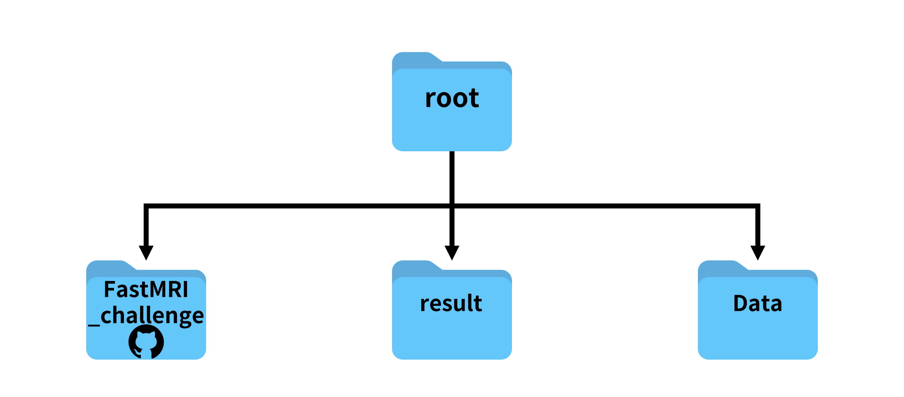
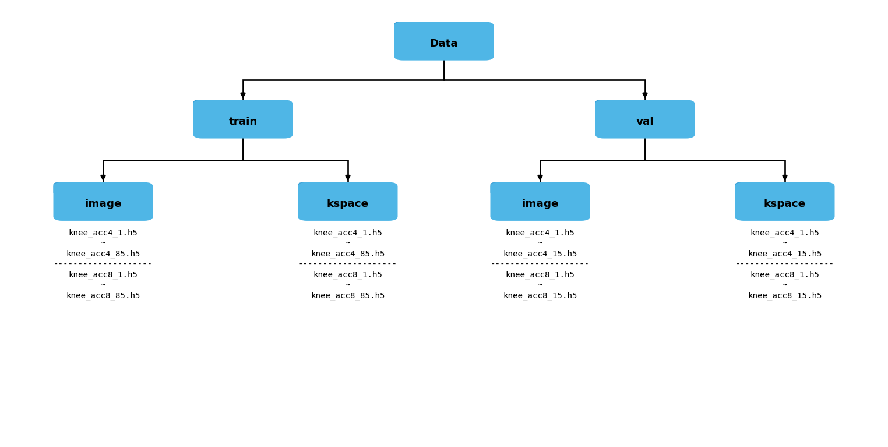

# FastMRI_SNU_2026_GMG
SNU FastMRI Challenge 도전기

---

# 2026 SNU FastMRI Challenge — Knee Annotation Track
2026 SNU FastMRI challenge — knee annotation reconstruction

* 본 repo의 현재 주 모델은 **PromptMR+**(영상도메인 cascaded deep unrolled model)입니다. undersampled k-space와 mask를 입력받아 **감도맵 추정·data consistency·정규화·복원·RSS·384 crop을 모델 내부에서** 수행합니다.
  * 백본 정의·전략은 **[`strategy/promptmr_plus.md`](strategy/promptmr_plus.md)** (현재 SPEC).
  * 기존 **E2E-VarNet** 경로(`--model varnet`)와 SDUM 코드(`utils/model/sdum/`)는 **레거시로 보존**되어 있으나 현재 실험 대상은 PromptMR+입니다.
* 본 대회는 **knee 데이터만** 사용하고, 가속률은 **acc4 / acc8**, 출력은 **384×384**입니다.
* 복원 품질은 두 SSIM의 **5:5 동일 가중 + 추론시간**으로 평가합니다 (2026-07-09 규칙 기준).
  * **SSIM_full**: foreground mask 내부 영역에 대해 평균한 SSIM
  * **SSIM_bbox**: fastMRI+ 병변 bounding-box 영역 안에서만 계산한 SSIM
  * 최종 점수 ≈ `0.5·SSIM_full + 0.5·SSIM_bbox + 추론시간`. SSIM 차가 미미할 때 **속도·모델 크기가 순위를 가름**.

## 1. 폴더 계층

### 폴더의 전체 구조

* `FastMRI_challenge`, `Data`, `result` 폴더가 위의 구조대로 설정되어 있어야 default argument를 활용할 수 있습니다.
* 본 github repository는 `FastMRI_challenge` 폴더입니다.
* `Data` 폴더는 MRI data 파일을 담고 있으며 아래에 상세 구조를 첨부하겠습니다.
* `result` 폴더는 학습한 모델의 weights을 기록하고 validation dataset의 reconstruction image를 저장하는데 활용되며, 아래에 상세 구조를 첨부하겠습니다.

### Data 폴더의 구조

* train, val:
    * train, val 폴더는 각각 모델을 학습(train), 검증(validation)하는데 사용하며 각각 image, kspace 폴더로 나뉩니다.
    * 참가자들은 generalization과 representation의 trade-off를 고려하여 train, validation의 set을 자유로이 나눌 수 있습니다.
    * image와 kspace 폴더에 들어있는 파일의 형식은 다음과 같습니다: knee\_{mask 형식}\_{순번}.h5
    * ex) knee_acc4_10.h5, knee_acc8_3.h5
    * {mask 형식}은 "acc4", "acc8" 중 하나입니다.
    * train은 "acc4", "acc8" 각각 {순번} 1 ~ 85, val은 각각 1 ~ 15 입니다.

### Annotation
* fastMRI+ knee 병변 bounding box는 각 image h5의 `attrs['annotations']`에 JSON으로 저장되어 있습니다.
* 형식: `{ "<slice>": [ {"x", "y", "width", "height", "label"}, ... ] }` (384 x 384 image 공간 기준, width·height가 16 초과인 박스만 포함)

### result 폴더의 구조
* result 폴더는 모델의 이름에 따라서 여러 폴더로 나뉠 수 있습니다.
* 각 모델 폴더는 아래 항목들로 구성되어 있습니다.
  * checkpoints - `model.pt`, `best_model.pt`의 정보가 있습니다. 모델의 weights 정보를 담고 있습니다.
  * reconstructions_val - validation dataset의 reconstruction을 저장합니다. knee\_{mask 형식}\_{순번}.h5 형식입니다. (```train.py``` 참고)
  * val_loss_log.npy - epoch별로 validation loss를 기록합니다. (```train.py``` 참고)

## 2. 폴더 정보

```bash
├── .gitignore
├── CLAUDE.md              # repo 작업 규칙
├── README.md
├── summary.md             # 프로젝트 통합 현황 (최신 상태 요약)
├── worklog.md             # 변경 히스토리 (누가·언제·왜)
├── train.py
├── train.sh · recon_eval.sh   # 실행 래퍼
├── recon_eval.py          # 고정 채점 하네스(수정 금지): SSIM_full·SSIM_bbox·추론시간 산출
├── requirements.txt
├── docs                   # README 이미지 등
├── scripts                # 보조 도구 (분석·탐침·병합)
│   ├── reconstruct.py     # leaderboard reconstruction 엔트리
│   ├── merge_moe.py       # acc4/acc8 전문가 → MoE 체크포인트 병합
│   ├── probe_oom*.py      # VRAM 탐침 (SDUM · PromptMR+)
│   └── ...                # bbox_ssim_breakdown·lesion_stats·coil_energy_report 등
├── shell_scripting        # GPU 작업 큐 (상세: shell_scripting/README.md)
│   ├── _train_template.sh      # 학습 슬롯 원본 ([고정 인자] + [이번 run] 구조)
│   ├── _evaluation_template.sh # reconstruct+채점 슬롯 원본
│   ├── shellN.sh          # 현역 큐 슬롯 (shell16~22)
│   ├── notify.sh          # 작업 완료 Gmail 알림
│   ├── legacy/            # 종료된 슬롯 보관 (shell1~14 등, 역할 표: legacy/README.md)
│   └── logs/              # 실행 로그 (git 미추적)
├── strategy               # 대회 전략·구현 문서 (인덱스: strategy/README.md)
│   ├── README.md          # 전략 문서 인덱스 + 상태 대시보드
│   ├── promptmr_plus.md   # ✅ 현재 백본 SPEC (PromptMR+)
│   ├── confirmed_model.md # 구 SDUM SPEC (superseded; 모델 무관 요소는 유효)
│   ├── candidates.md      # 미결정 후보·열린 A/B
│   ├── rejected.md        # 제외한 기법 + 이유
│   └── ...                # model_strategy·augmentation·preprocessing·related_work (근거)
├── training_anal          # run별 학습 분석 기록 (run 이력 표: training_anal/CLAUDE.md)
├── utils
│   ├── common
│   │   ├── loss_function.py  # SSIMLoss(masked) + bbox_ssim_loss
│   │   ├── metrics.py        # ssim_full·ssim_bbox·foreground_mask (채점 정합, 고정)
│   │   └── utils.py          # center_crop·save_reconstructions 등
│   ├── data
│   │   ├── load_data.py      # 데이터셋 로딩 + GRAPPA 로딩 + dataloader 배선 (k-fold 분할 포함)
│   │   └── transforms.py     # DataTransform(readout crop·정규화·GRAPPA·coil compression) + MRIAugmentor
│   ├── learning
│   │   ├── test_part.py      # load_model·prep_volume·recon_slice(채점 하네스 계약) + forward
│   │   └── train_part.py     # train/train_epoch/validate (손실·grad accum·clip·resume)
│   └── model
│       ├── fastmri/          # vendored fastMRI 연산 (fft·complex·coil combine·sens_expand)
│       ├── promptmr/         # ★ PromptMR+ 백본(vendored·slim) + config·adapter
│       ├── moe.py            # acc4/acc8 MoE 라우팅 래퍼 (MoEWrapper)
│       ├── sdum/             # 레거시 SDUM (보존, 배선 제거)
│       ├── unet.py           # VarNet 내부 regularizer U-Net
│       └── varnet.py         # 레거시 E2E-VarNet 백본
└── viewer_result          # h5_viewer.py 뷰어 + 시각화 산출물
```

## 3. Before you start
* 현재 주 모델은 **PromptMR+**입니다. `utils/model/promptmr/adapter.py`가 우리 파이프라인과의 접합부이며, 계약은 `forward(k-space (B,C,H,W,2), mask (B,1,1,W,1)) -> image (B,384,384)`입니다.
* PromptMR+는 **knee·정적 2D·단일 슬라이스·Cartesian 전용**으로 슬림화되어 있습니다(인접-슬라이스 SME·비-Cartesian 분기 제거, 원본과 bit-단위 등가 검증). self-adaptive gradient·momentum은 유지.
* phase1에서는 ```train.py```로 학습/검증을 진행합니다.
* ```train.py```
   * train/validation을 진행하고 학습한 model의 결과를 result 폴더에 저장합니다.
   * 가장 성능이 좋은 모델의 weights을 ```best_model.pt```으로 저장합니다.
   * **PromptMR+ 주요 hyperparameter**:
      * ```--model promptmr``` : 백본 선택 (기본 `varnet`, 레거시)
      * ```--num-cascades``` : cascade 수 T (기본 10). 클수록 성능↑·메모리/시간↑
      * ```--n-feat0``` : 복원 U-Net base 폭 (기본 48)
      * ```--sens-n-feat0``` : 감도맵 U-Net base 폭 (기본 24)
      * ```--n-history``` : momentum history 길이 (기본 3, 원본 11 — 메모리 레버)
      * ```--use-checkpoint``` : gradient checkpointing (기본 on, 8GB VRAM용)
   * **학습 설정**: 손실 `--fg-loss --area-weight`(masked SSIM × √foreground 면적비), 옵티마이저 AdamW(`-l 1e-6`), `--grad-clip 0.1`, `--accum-steps 2`. 병변 가중은 `--bbox-loss-lambda`로 추가(선택).
   * 대형 모델이므로 **batch size는 1**, GTX 1080 8GB에서는 **FP32**로 학습합니다.
* val 자가채점
   * ```utils/common/metrics.py```의 ```ssim_full```, ```ssim_bbox```로 본인 validation reconstruction의 SSIM을 직접 계산할 수 있습니다. (annotation은 각 image h5의 ```attrs['annotations']```에 포함)
* ```recon_eval.py``` / ```scripts/reconstruct.py``` (leaderboard 데이터 배포 후 사용)
   * ```train.py```으로 학습한 ```best_model.pt```을 활용해 leaderboard dataset을 reconstruction·채점하는 스크립트입니다.
   * phase1에서는 leaderboard 데이터가 제공되지 않으므로 아직 실행할 수 없습니다.

## 4. How to set?
(server: Python 3.10.12 / torch 2.3.1+cu121 에서 동작 검증. README 타깃은 3.12.9)
```bash
pip3 install -r requirements.txt
```

## 5. How to train?
```bash
python train.py --model promptmr \
  --num-cascades 10 --n-feat0 48 --sens-n-feat0 24 --use-checkpoint \
  --fg-loss --area-weight -l 1e-6 --grad-clip 0.1 --accum-steps 2 \
  -n <net_name> -e <epochs> -t <train_dir> -v <val_dir>
```
- validation할 때, reconstruction data를 ```result/<net_name>/reconstructions_val/```에 저장합니다.
- epoch 별로 validation dataset에 대한 loss를 기록합니다.
- **seed 고정**을 하여 이후에 Re-training하였을 때 **같은 결과가 나와야 합니다**.
- GPU 작업은 큐 스크립트(`shell_scripting/`)로 실행합니다(상세: `shell_scripting/README.md`).

## 6. How to reconstruct? / self-scoring (leaderboard 데이터 배포 후)
> phase1에서는 leaderboard 데이터가 제공되지 않으므로 이 단계는 아직 실행할 수 없습니다.

```bash
python recon_eval.py -n <net_name> -p /root/Data/leaderboard   # SSIM_full·SSIM_bbox·추론시간 3축 채점
```
- acc4 / acc8 각각의 reconstruction과 시간을 산출하고, 볼륨당 시간 초과를 경고합니다.

## 7. What to submit!
- github repository(코드 실행 방법 readme에 상세 기록)
- loss 그래프 혹은 기록
- 모델 weight file
- 모델 설명 ppt

## 8. 전략 문서 (`strategy/`)
> 대회 준비용 리서치·구현 전략 문서. **인덱스와 상태 대시보드는 [`strategy/README.md`](strategy/README.md)**.

* **[`strategy/promptmr_plus.md`](strategy/promptmr_plus.md)** — ✅ **현재 백본 SPEC(PromptMR+)**: 구조(cascade10·feat48·sens24)·손실(masked SSIM×√면적비)·옵티마이저·slim·실행법.
* **[`strategy/README.md`](strategy/README.md)** — 전략 문서 인덱스 + 상태 대시보드(✅확정 / 🔬후보 / ❌제외).
* [`strategy/confirmed_model.md`](strategy/confirmed_model.md) — 구 SDUM SPEC(superseded). **모델 무관 요소**(readout crop·정규화·GRAPPA·감도맵)는 여전히 유효.
* [`strategy/candidates.md`](strategy/candidates.md) — 미결정 후보·열린 A/B. [`strategy/rejected.md`](strategy/rejected.md) — 제외한 기법 + 이유.
* 근거(rationale) 아카이브: [`model_strategy.md`](strategy/model_strategy.md) · [`augmentation.md`](strategy/augmentation.md) · [`preprocessing.md`](strategy/preprocessing.md) · [`related_work.md`](strategy/related_work.md).

### 데이터 증강(Augmentation) 전략 요약
> 원칙: **hallucination-free lesion fidelity** — 병변 bbox를 훼손하지 않고 물리적으로 유효한 변형만. (상세: [`augmentation.md`](strategy/augmentation.md))

* **채택(ON)**: ① 좌-우(phase-encode) **flip** — k-space·GRAPPA·target·bbox 동기. ② **ACS 보존 마스크 thinning**(중앙 ACS 100% 보존, 주변부만, k-space에만). ③ (기본 off) k-space 랜덤 위상·보수적 측정 노이즈.
* **스케줄**: `--aug-delay D`(기본 0)까지는 off → `--aug-schedule exp|ramp|constant`로 총 epoch T까지
  `--aug-max-prob`(기본 0.55)까지 점증, 샘플별 **결정적 RNG**(재현성). **기본 off — `--aug-on` 필요.**
* **제외**: 위-아래 flip·회전/스케일/elastic·image 노이즈·밝기/대비·cutout·MixUp/CutMix(병변 왜곡=hallucination, SSIM_bbox 파괴).

### 전처리(Preprocessing) 전략 요약
> 원칙: 네트워크 입력 **전 결정적 가공**으로 8GB·추론시간을 줄이되 화질은 무손실/중립. (상세: [`preprocessing.md`](strategy/preprocessing.md))

* **✅ 확정(모델 무관)**: ① **Readout crop 640→384**(readout 완전샘플이라 무손실, VRAM≈40%↓, 폭 native 유지). ② GRAPPA는 **영상 도메인 유지**(fft 안 함).
* ⚠️ PromptMR+는 감도맵·DC·**정규화를 내부에서** 처리하므로 외부 `--normalize`(전역 ÷s)는 **off**로 둡니다.
* **🔬 효율 후보(구현됨, 기본 off)**: **SVD coil compression** 15→8 가상코일(속도/VRAM 레버, ACS 기반 추론 안전).
